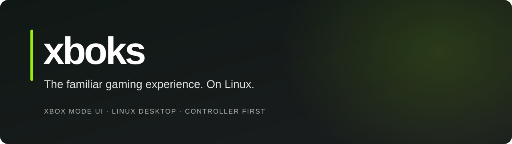
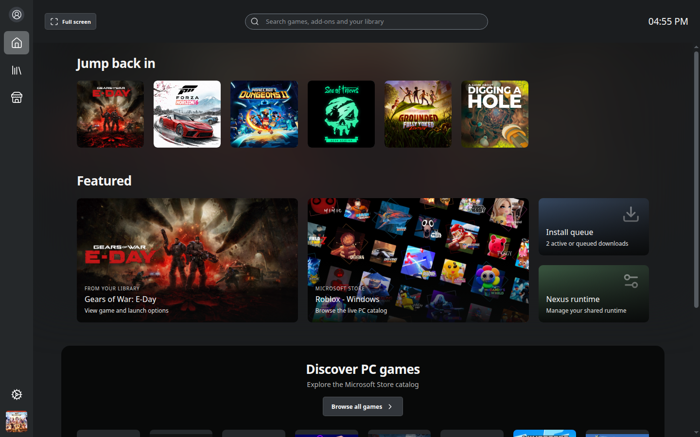

<div align="center">



**A Linux gaming client built toward the familiar Windows Xbox experience.**

[](https://github.com/slaveitgr/xboks/actions/workflows/ci.yml)
[](LICENSE)
[](#get-started)
[](#what-works-today)

**English · [Ελληνικά](README.el.md)**

[Features](#what-works-today) · [Get started](#get-started) · [Fullscreen Experience](#fullscreen-experience--game-bar) · [Roadmap](#roadmap) · [Credits](#built-on-xodus-and-xodus-nexus)

</div>

xboks brings a reference-driven Xbox-style interface to Linux: Home, Game Pass browsing, a combined library, Store, game pages, installation queue, settings and a desktop guide. Its **xboks Engine** provides the managed backend and Proton/runtime integration for supported games. The [upstream foundation and licenses](#built-on-xodus-and-xodus-nexus) remain credited below.

> **Independent development project.** The target is faithful visual and interaction parity with the Windows Xbox client. That work is ongoing. xboks is unofficial, and neither complete Windows feature parity nor universal game compatibility is claimed.

## What works today

| Area | Implemented | Current boundary |
| --- | --- | --- |
| Home, Library, Game Pass and Store | Compact navigation, catalog browsing, filters, product-specific game pages, menus and installation queue | Exact visual parity and complete service coverage remain in progress |
| Settings | Nine reference categories, provider pages, Greek/English controls and integrated xboks Engine/Proton settings | Windows-specific services follow actual Linux capabilities |
| Accounts and games | Microsoft account integration through xboks Engine, entitlement-aware access, installation and runtime tooling | Download-to-launch acceptance remains game-specific; owning a license is required |
| Friends and presence | Shared app/guide service, player search and presence reported by Xbox | Authenticated friends and inbox reads have been exercised; unavailable presence stays unknown |
| Text conversations | One-to-one inbox/history, explicit Send, account/participant validation and no automatic resend | Sending is fixture-tested; live delivery remains to be verified. Group/system threads are omitted |
| Fullscreen Experience | Optional GNOME Shell 51 extension, acknowledged app/desktop transitions and emergency restoration | Prototype: live GNOME/dock/lock/controller acceptance remains pending; a standalone gaming session comes later |
| Desktop header | Xbox mode entry in desktop windows; clock and real system power status in fullscreen | Unknown battery/charging data is not invented; window fullscreen and OS integration are reported separately |
| Installation dialog | Content confirmation, required base package, real install location, scoped Back and an explicit final Install action | Optional language/chunk selection and disk sizes need additional engine metadata; alternative package IDs are single-choice |
| Handheld information | Dedicated reference-style page with the explicit Xbox public-catalog classification and Greek/English labels | Ratings describe Windows handhelds, not Linux/Proton compatibility or performance on this PC; absent data stays unknown |
| Desktop guide | Separate top-level Game Bar-style window, scoped menus/Back, system audio and xboks-window screenshots | A native compositor Game Bar over external games remains pending; shortcuts and video capture have separate limits |
| Linux controls | NetworkManager Wi-Fi, BlueZ paired-device controls and capability-gated session/power actions | New pairing/network setup uses desktop settings; disruptive actions require confirmation |
| Audio tools | Explicit local microphone test, device selection, level meter, optional monitoring, mute, push to talk and supported noise suppression | These tools test audio on this PC; **Xbox party voice is not connected** |
| Console Remote Play | Dedicated window for Microsoft's official console web client | Discovery, sign-in and streaming are owned by that site; the native Windows flow and Xbox One X acceptance remain open |

The default game installation directory is **`~/Games/Xboks`**. The old default `~/Games/Xodus Nexus` is migrated in settings; custom locations are preserved and existing game files are not moved automatically.

The [handheld compatibility analysis](docs/analysis/reference/handheld-compatibility.md) records the original package's data contract and layout. The app reads the public Xbox product service without account credentials; this descriptive rating does not change license, installability or Play decisions.



*Captured development preview with sample library data and public catalog artwork. It illustrates the interface, not game compatibility or completed feature parity.*

### Voice: current work and next step

The local microphone test is available in Sound settings and the guide's Audio panel. Capture starts only after **Start test**. Monitoring starts off; closing or hiding the test releases the microphone. Device/output selection and noise suppression depend on what the desktop and Chromium expose. Test audio is neither recorded nor sent to Xbox, and the test's push-to-talk control is local to its window.

Independent Xbox party voice still needs the consumer-party signaling/authentication adapter, a Linux media worker and cross-device acceptance. The original package's `xCommsUwp` → `PartyWin` dependency and PlayFab identity/network fields are documented in the [party voice analysis](docs/analysis/reference/party-voice.md). Microphone access, a party roster or a successful library build alone is not evidence of working Xbox voice.

## Get started

Use **Node 22**, npm and a Linux desktop that can run Electron. The current backend build targets Linux x86_64.

```sh
git clone https://github.com/slaveitgr/xboks.git
cd xboks
npm ci
npm run dev
```

For a UI preview with sample account/library data:

```sh
XBOKS_DEMO=1 npm run dev
```

Demo mode does not sign in, install or launch real games. It can fetch public Store catalog data and artwork.

For real use, configure **xboks Engine** and its shared runtime in Settings, then sign in through the Account flow. Supported games use the configured Proton/runtime; account privileges, licenses, runtime compatibility and the game itself determine availability. The default runtime location is `<XDG data home>/xboks/engine/runtimes`; the backend lives under the xboks profile's `engine/` directory.

Launcher, backend and runtime update checks now use **[slaveitgr/xboks releases](https://github.com/slaveitgr/xboks/releases)**. They do not fall back to upstream project binaries or require a GitHub login for runtime downloads. A compatible, complete xboks release must actually be published before it can be installed this way; changing the channel does not create those releases. Microsoft sign-in, game payloads, catalog and required redistributables continue to use their actual vendor services. See the [download and source-provenance audit](docs/engine-downloads.md).

### Check and package

```sh
npm run typecheck
npm test
npm run build
npm run dist
```

`npm run build` includes type checking and the full launcher test suite. `npm run dist` repeats the build and creates an AppImage under `release/`; it does not publish a GitHub release. Packaging on one host does not establish compatibility with every Linux distribution.

### Optional social companion — backend 0.3.0

Friends/chat use the selected backend when it advertises social support. A packaged build can instead include the **0.3.0 social companion**, without replacing the selected game backend. It reads the existing compatible account credentials through a read-only path; expired credentials need the normal Account refresh/sign-in flow.

To build the companion from the pinned source recipe, use the Rust toolchain in [`assets/backend-source.lock.json`](assets/backend-source.lock.json) and the native prerequisites in [`scripts/BACKEND.md`](scripts/BACKEND.md), including `protoc`:

```sh
mkdir -p work outputs
node scripts/build-backend.mjs --work work/social-build --output outputs/social-backend
node scripts/bundle-social-backend.mjs \
  --binary work/social-build/target/release/xodus-cli \
  --license work/social-build/source/LICENSE \
  --source-archive outputs/social-backend/xboks-engine-backend-0.3.0-linux-x86_64-source.tar.xz
npm run dist
```

The private Cargo build output remains named `xodus-cli`; the bundler publishes its verified bytes as `xboks-engine`. Work/output directories must be new; the bundler also refuses to overwrite `assets/social-backend/`. Generated binaries and their corresponding-source archive stay out of Git. The companion is checked by hash and a bounded help probe, never used for login or game execution, and does not enable party voice. The local companion's OpenSSL 4/glibc dependencies and verification scope are recorded in the [social/system integration report](docs/analysis/social-system-integration.md).

## Fullscreen Experience & Game Bar

**0.3.13 adds an optional GNOME Shell 51 Fullscreen Experience prototype.** In a desktop window, the top-right header has one **Xbox mode** button. In fullscreen, that button is replaced by the clock and available system battery/power status. Battery level, charging and external power come from Linux; unknown values stay unknown. No desktop clock or fabricated charging indicator is shown beside the entry button.

With the extension installed, discovered and enabled, an explicit request from the focused launcher can temporarily hide supported GNOME shell chrome. The app's persistent local bridge owns that mode and releases it on exit or connection loss. **Ctrl+Super+Escape** is the emergency restore shortcut; entering the mode requires that shortcut to be available. Locking or disabling the extension also releases its changes, and unlocking does not automatically re-enter.

This keeps the existing desktop applications, GNOME compositor and desktop services running. It does **not** free their RAM, terminate background applications or create a dedicated gaming session. Without the extension, the app can still enter ordinary window fullscreen and reports that system Xbox mode is unavailable. A window becoming fullscreen is not evidence that GNOME integration is active.

### Install the optional GNOME extension

From a source checkout on **GNOME Shell 51**, use a new staging directory:

```sh
python3 scripts/desktop/stage-gnome-experience.py \
  --output work/gnome-experience/install-stage --install
```

The script checks the Shell version, refuses an existing extension destination and installs the extension **inactive**. It does not enable it, enter Xbox mode, change desktop settings or end the session. Omit `--install` to stage files only. Other GNOME major versions are not supported by this prototype.

Packaging also includes the extension source and installer. From an extracted AppImage directory containing `resources/`, the equivalent command is:

```sh
python3 resources/desktop/stage-gnome-experience.py \
  --source resources/gnome-extension/xboks-experience@slaveitgr.github.io \
  --output /tmp/xboks-experience-install-stage --install
```

The output directory must be new; neither command overwrites an existing extension.

A **new local extension needs a fresh GNOME session to be discovered**. Save your work, then log out and back in when you choose; the installer and app do not do this automatically. Installation alone cannot activate the extension in the currently running session. After the fresh login:

```sh
gnome-extensions enable xboks-experience@slaveitgr.github.io
gnome-extensions info xboks-experience@slaveitgr.github.io
```

Enablement makes the integration available; it does not enter the mode until you choose **Xbox mode** in xboks. To disable the extension:

```sh
gnome-extensions disable xboks-experience@slaveitgr.github.io
```

See the [extension setup and protocol](desktop/gnome/xboks-experience@slaveitgr.github.io/README.md) and [Linux session architecture](docs/analysis/fullscreen-experience-linux.md). A separate Gamescope/Kiosk gaming session for the distribution remains future work. `XBOKS_FULLSCREEN_EXPERIENCE=1` describes an already established distribution session; setting it does not create one.

Automated tests cover ownership/restoration logic, mocked Shell behavior, the real GJS helper communicating with a fake service on an isolated D-Bus, app fullscreen transitions and battery/header states. These are **fixture/protocol tests**. Live GNOME panel/dock restoration, lock/unlock, multi-monitor operation, physical shortcuts/controllers and behavior over real games still need acceptance testing.

### Controller navigation and Game Bar

D-pad/left stick moves focus, A selects, B goes back and LB/RB switches the active page, tab or guide section. Mouse and keyboard remain available. Open the guide through its app control, **Ctrl+G** in the app, the controller Guide button when exposed by the OS, or **`--game-bar`**. For a GNOME **Win+G** binding to an existing AppImage:

```sh
python3 scripts/desktop/install-gnome-gamebar.py \
  --command '/absolute/path/to/xboks.AppImage --game-bar'
```

That shortcut helper preserves other bindings and refuses an existing Win+G conflict. The guide currently uses a separate Electron desktop window. The Fullscreen Experience extension does **not** turn it into a native compositor overlay: global Game Bar stacking/input over external games on Wayland remains pending. System volume uses PipeWire/WirePlumber (`wpctl`); screenshots capture the xboks window, not arbitrary games or the whole desktop.

## Reconstruction and verification

The visual reference is **Windows Xbox app 2610.1001.20.0 in Xbox mode** and the supplied screenshots. The [reference library](docs/analysis/reference/README.md) connects screenshot observations, decoded resources, control/navigation contracts, native metadata and implementation instructions. The [verification matrix](docs/analysis/reference/verification-matrix.json) keeps static evidence, Windows observations and tested Linux behavior distinct.

Start with:

- [Implementation guide](docs/analysis/reference/implementation-guide.md) — components, data contracts and acceptance gates.
- [Application implementation report](docs/analysis/reference/app-implementation-2026-10-21.md) — UI/navigation checks and remaining gaps.
- [Social/system integration](docs/analysis/social-system-integration.md) — real adapters, authenticated read checks, packaging and limits.
- [Xbox party voice](docs/analysis/reference/party-voice.md) — recovered native/signaling evidence and the Linux voice plan.

Synthetic tests, authenticated service checks, physical-controller checks and audible cross-device voice acceptance establish different things. Reverse-engineering counts are not a completion percentage.

## Roadmap

- [x] Establish the xboks Engine foundation and preserve upstream attribution.
- [x] Build the original-package/screenshot reference library.
- [x] Implement reference-driven browsing, product pages, menus, queue and nine Settings categories.
- [x] Add scoped controller navigation and the separate desktop guide.
- [x] Integrate Xbox friends/text-chat adapters and Linux system controls.
- [x] Add explicit local audio/device testing with cleanup and local push to talk.
- [x] Implement the optional GNOME 51 Fullscreen Experience prototype and fullscreen-only clock/system-power header.
- [ ] Complete live GNOME entry/restore, lock/unlock, dock, multi-monitor and physical-controller acceptance.
- [ ] Add a native compositor Game Bar with verified global input and external-game stacking.
- [ ] Complete screenshot-by-screenshot visual and interaction parity.
- [ ] Verify live text-message delivery and broader account/service cases.
- [ ] Complete independent Xbox party signaling and native Linux voice, including two-way audible acceptance.
- [ ] Validate more games through installation, update, launch and recovery.
- [ ] Validate physical controllers, Wayland/global overlay behavior and clean-machine packages.
- [ ] Integrate a separately supervised Gamescope/Kiosk gaming session with an explicit desktop-return flow.
- [ ] Publish reproducibly tested releases after clean-machine and game acceptance.

## Built on Xodus and Xodus Nexus

| Project | Foundation |
| --- | --- |
| [Xodus](https://github.com/xodus-gaming/xodus) | Xbox PC account, licensing, package and Linux compatibility infrastructure |
| [Xodus Nexus](https://github.com/domsvoboda/xodus-nexus) | The Electron/React launcher xboks is derived from, backend integration, library, queue and runtime tooling |
| [Xodus Proton](https://github.com/xodus-gaming/Proton) · [Xodus XGameRuntime](https://github.com/xodus-gaming/xgameruntime) | Parts of the configured game compatibility/runtime foundation |
| [OpenXbox](https://github.com/OpenXbox/xbox-webapi-python) | Primary open-source references for the implemented social service contracts |

The original **Xodus Nexus contributors** copyright notice and MIT launcher license remain in [LICENSE](LICENSE). Backend/runtime components retain their own licenses; corresponding source accompanies the optional social companion. Microsoft package binaries and private extracted reference datasets are not committed to this repository.

Contributions are welcome: reproducible UI comparisons, accessibility/controller fixes, Linux integration and game compatibility reports. Include the revision, distribution, backend/runtime versions and reproduction steps. Remove credentials and personal data from shared logs/screenshots. Report xboks issues [here](https://github.com/slaveitgr/xboks/issues).

---

**Unofficial and independently maintained.** xboks is not affiliated with or endorsed by Microsoft, Xbox, Xodus or Xodus Nexus. Xbox and related names belong to their respective owners.
