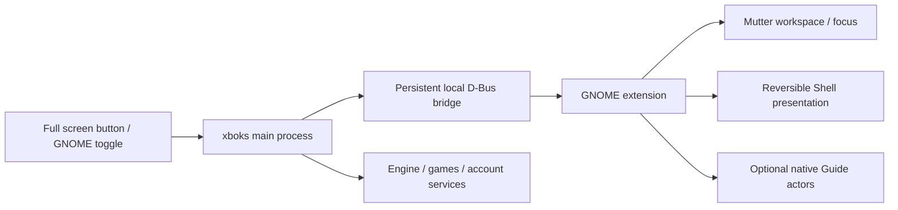

# Fullscreen Experience on Linux

Research date: 2026-10-21. This document proposes the OS integration boundary; it does not certify a working console session, GNOME extension, or overlay over games. The recommended first implementation is a reversible **GNOME Shell integration**, followed by an independently tested **Gamescope session** for the distribution. An application's fullscreen window remains a separate capability.

## Evidence and present boundary

Read-only probes on the development host reported Ubuntu GNOME on Wayland, GNOME Shell **51.0**, GJS **1.90.0**, and Gamescope **3.16.24+ds-2**. The public ShellVersion D-Bus property also returned 51.0. `XDG_SESSION_ID` was absent from this process, so environment variables alone are insufficient to identify the controlling login session. GNOME's own login manager handles that case by asking logind for the current session. [GNOME Shell 51 login manager](https://github.com/GNOME/gnome-shell/blob/51.0/js/misc/loginManager.js#L129-L153).

The baseline code inspected at the start of this investigation has these boundaries:

- [`desktop-settings.ts`](../../src/main/desktop-settings.ts) recognizes an explicitly supplied `XBOKS_FULLSCREEN_EXPERIENCE=1` session marker. It does not infer an OS gaming session from a desktop name or fullscreen window.
- `XboxFullButton` in [`App.tsx`](../../src/renderer/App.tsx) uses the browser Fullscreen API and a DOM attribute to enable the controller-oriented application presentation. That alone does not change GNOME's session or shell.
- [`desktop-guide.ts`](../../src/main/desktop-guide.ts) creates a separate transparent Electron window, requests always-on-top, and focuses that window. These requests do not establish compositor-side stacking/input control.
- [`install-gnome-gamebar.py`](../../scripts/desktop/install-gnome-gamebar.py) can configure an explicit GNOME custom shortcut. It is not an extension or console-session manager.
- [`launcher-environment.ts`](../../src/main/launcher-environment.ts) and its session tests preserve caller display endpoints instead of publishing them to the shared user manager or bus.

An optional bridge/prototype may be implemented alongside this research. Its behavior and verification must be recorded separately; the architecture below is not an implementation-completion claim.

GNOME extensions execute inside Shell and can use Mutter's workspace/window facilities and Clutter/St actors. They are appropriate for changing desktop presentation and providing Shell-owned UI. They also have the ability to break the shell, so the bridge should remain small. [GNOME extension architecture](https://gjs.guide/extensions/overview/architecture.html).

## Three distinct capabilities

| Capability | What actually changes | Desktop applications survive the transition | Intended role |
|---|---|---|---|
| App window fullscreen | The xboks window and controller presentation | Yes | Universal fallback |
| GNOME shell integration | The existing desktop's workspace, focus, selected shell chrome and optional Shell-owned Guide | Yes; processes and credentials remain in the same login session | First practical Fullscreen Experience on this GNOME host |
| Standalone gaming session | The session compositor and supervised application tree | Not through logout; a separately preserved concurrent desktop requires a distinct supported switching design | Console-first distribution boot/login |

Running Gamescope as a fullscreen **nested** window belongs to the existing desktop session. Standalone/embedded Gamescope can use DRM/KMS directly. These are different deployment paths, with different display ownership and performance characteristics. The `-f` flag alone does not select the standalone session path. [Gamescope 3.16.24 README](https://github.com/ValveSoftware/gamescope/blob/3.16.24/README.md).

## Recommended GNOME integration

The following is a proposed contract, not an existing GNOME API:



Keep game launch, auth, downloads, social operations and media processing in existing application/backend processes. The extension only controls the Shell surface, tracks a specific app window, and exposes a small versioned bridge. A native Guide would share sanitized view models/actions with the application; it cannot directly render the existing React DOM as an St actor.

Suggested operations are `GetState`, `Enter`, `KeepAlive`, `Leave`, and later `ToggleGuide`. Arguments should be bounded typed values, with no arbitrary command, JavaScript, file path, or window-title selector. Identify the xboks window using a registered process/window binding and validated app identity, not a substring such as “Xbox”. Return explicit capabilities, current state, protocol version and a reason when unavailable. The app should report GNOME integration active only after the extension acknowledges it; do not manufacture an environment marker to simulate success.

Use an app-owned GSettings schema and Shell keybinding for activation, plus a GNOME Quick Settings entry as a visible recovery route. GNOME documents `QuickSettings.SystemIndicator` and its external indicator registration. Shell's own window manager implements paired keybinding registration/removal. [Quick Settings extension guide](https://gjs.guide/extensions/topics/quick-settings.html), [GNOME Shell 51 keybindings](https://github.com/GNOME/gnome-shell/blob/51.0/js/ui/windowManager.js#L1001-L1014).

Never use `org.gnome.Shell.Eval` or enable Shell unsafe mode for application integration. GNOME 51 explicitly refuses Eval without unsafe mode. A dedicated exported object is a narrower, reviewable interface. A lease bound to a D-Bus sender requires a persistent connection: each one-shot `gdbus call` process has a transient connection. If a helper is used, its parent-process/pipe lifetime must be tied to xboks. A token/heartbeat design must document its ownership rules rather than claiming sender-disconnect protection it does not implement. [GNOME Shell 51 D-Bus implementation](https://github.com/GNOME/gnome-shell/blob/51.0/js/ui/shellDBus.js#L19-L82).

### Entry, exit and recovery

Proposed state machine:

```text
desktop -> entering -> active -> leaving -> desktop
                 \-> recover -> desktop
active -> locked/inactive -> desktop or explicit re-entry after unlock
```

On entry, capture the previous focused window, workspace, xboks geometry/fullscreen state, and only the shell properties that the extension will actually change. Prefer a dedicated workspace and move only xboks and games the launcher owns. Leave unrelated applications alone. Mutter exposes window fullscreen, workspace and activation operations. [Mutter window methods](https://mutter.gnome.org/meta/method.Window.make_fullscreen.html), [workspace changes](https://mutter.gnome.org/meta/method.Window.change_workspace.html), [activation](https://mutter.gnome.org/meta/method.Window.activate.html).

Set a finite entry deadline. If the app window never arrives, the lease expires, the process/helper disappears, or preparation fails, restore the desktop immediately. Do not hide the panel before there is an identified usable target. Avoid globally changing the user's dock extension, disabling other extensions, or persisting desktop preferences merely to enter the mode. Fullscreen/workspace presentation should provide most of the first prototype; more invasive chrome policies need explicit support and recovery tests.

On exit, release input grabs before moving/restoring windows. Restore the extension's own changes in reverse order. Keep live object references and tolerate destroyed windows, removed workspaces and unplugged monitors; workspace indices and monitor positions are not permanent identities. Restore focus only to a still-existing prior target. Leave running games and downloads alive. “Return to desktop” must not implicitly terminate a game, logout, reset credentials or change the selected engine.

GNOME requires cleanup in `disable()`, and GNOME 51 rejects an asynchronous `disable()` method. Teardown must synchronously disconnect signals, remove timers/keybindings, release grabs, remove actors, unexport the bridge and restore owned presentation. Any async work needs cancellation/generation checks before applying a result. Use `Clutter.Orientation.VERTICAL`, not the removed St `vertical` property. Start with Shell 51 support and test additional major versions before advertising them. [Extension lifecycle rules](https://gjs.guide/extensions/review-guidelines/review-guidelines.html), [GNOME 51 porting guide](https://gjs.guide/extensions/upgrading/gnome-shell-51.html).

GNOME's Wayland compositor cannot be casually restarted in place to recover a broken extension. Development should use a disposable VM or a deliberately prepared devkit session. GNOME's own documentation warns that nested Shell is not fully isolated; GNOME 49+ uses the devkit invocation rather than the older nested flag. No nested or replacement Shell was launched during this investigation. [GNOME extension debugging](https://gjs.guide/extensions/development/debugging.html#reloading-extensions).

### Lock screen and global Guide

Start with the extension enabled only for normal user sessions. Check both current and parent session mode because Ubuntu and other distributions use custom modes. Any transition to locked, greeter, or inactive state must dismiss the Guide, release input, cancel media capture and stop accepting activation requests. Unlock does not silently resurrect a privileged overlay. GNOME may call extension disable/enable during lock transitions. A GNOME “session mode” here is a Shell environment state, not a fresh Linux login session. [Session modes guide](https://gjs.guide/extensions/topics/session-modes.html), [GNOME Shell 51 mode definitions](https://github.com/GNOME/gnome-shell/blob/51.0/js/ui/sessionMode.js).

For a Guide that reliably belongs above GNOME-managed games, use Shell actors with tracked input regions and deliberate modal focus. In Shell 51, `addChrome` places actors below `top_window_group`; `addTopChrome` places them above windows/popups. `trackFullscreen:true` hides a tracked actor when a fullscreen window is present, which is unsuitable for a Guide that should remain visible over that game. Do not apply an above-windows actor to the lock screen. [GNOME Shell 51 layout implementation](https://github.com/GNOME/gnome-shell/blob/51.0/js/ui/layout.js#L789-L821).

A Shell modal grab is a resource, not a permanent gameplay input mode. Pair each successful acquisition with the matching release, including error/disable/lock paths; restore the previous focus when closing. Physical gamepad navigation requires its own tested input route. The browser Gamepad API in a hidden Electron window is not proof of globally delivered controller input. [Shell modal/focus implementation](https://github.com/GNOME/gnome-shell/blob/51.0/js/ui/main.js#L627-L744).

The proposed policy must also yield to system authentication/accessibility dialogs. Defer activation when another Shell modal owns input; close/ungrab on a system-modal transition. Keep the normal lock shortcut and an emergency desktop return available. Above-windows drawing is not permission to obscure the lock screen or a polkit password prompt.

The GNOME extension does not automatically become a Gamescope overlay. It owns the outer GNOME Shell, while Gamescope owns its internal surfaces. Native Shell presentation over nested Gamescope and a native Gamescope-session Guide need separate focus, fullscreen and controller tests.

## Distribution session: Gamescope or GNOME Kiosk

For the distribution, install an explicit gaming session entry and a supervised launcher rather than overwriting the normal desktop session. The session entry starts a session-scoped supervisor, the compositor, required desktop services and xboks. In Gamescope 3.16.24 source, `--backend drm` selects a standalone display backend; `--backend wayland` and SDL are distinct backends, and `--expose-wayland` exposes xdg-shell clients. These switches are evidence of available primitives, not a complete login-session recipe. [Gamescope main/option implementation](https://github.com/ValveSoftware/gamescope/blob/3.16.24/src/main.cpp#L152-L195).

The supervisor should confirm compositor readiness before starting xboks; restart only the owned frontend with backoff and a failure ceiling; retain a controller/keyboard-accessible recovery path. Launcher failure must not create an endless black-screen restart loop. Quitting a session intentionally is different from a launcher crash. Track games separately so restarting the frontend does not kill them unexpectedly; do not exit the compositor until the game/save/installation policy permits it.

Keep `DISPLAY`, `WAYLAND_DISPLAY`, IME and graphics settings scoped to that session's children. Never overwrite the shared user manager's display environment as a shortcut to making keyring, browser or auth services work. Use the same Linux account, existing xboks profile and existing Secret Service contract. A live frontend must own the profile exclusively; two concurrent graphical sessions cannot safely run two writers against the same Electron profile and state store. Keep account credentials out of session handoff files.

Returning from a standalone session has two possible products:

- **End gaming session, log into desktop:** simplest controlled distribution flow; do not promise that previously open desktop windows survive logout. Require an explicit user action and active-game/download checks.
- **Switch between two preserved sessions:** a separate design involving the display manager/session controller, seat/display ownership, session locking and duplicate user services. It is not implied by starting another Gamescope process. Do not implement this by killing GNOME Shell, restarting the display manager, or issuing logout behind the Fullscreen Experience button.

A Gamescope Guide also needs a compositor-specific adapter. The inspected control protocol is explicitly private; its existence does not establish a stable general-purpose overlay contract. Gamescope's default **Super+G toggles keyboard grab**, so the desired Game Bar key must be deliberately reconciled with compositor shortcuts. [Gamescope control protocol](https://github.com/ValveSoftware/gamescope/blob/3.16.24/protocol/gamescope-control.xml), [Gamescope keyboard bindings](https://github.com/ValveSoftware/gamescope/blob/3.16.24/README.md#keyboard-shortcuts).

**GNOME Kiosk** is another real session option: a minimal Mutter-based Wayland compositor that starts applications fullscreen without desktop panels/docks. Its sample uses a display-manager session file, a GNOME Session description and the application desktop entry. It is a reasonable fallback for a controlled appliance, while gaming-specific display/overlay behavior still needs implementation and measurement. A normal GNOME Shell extension is not automatically loaded into GNOME Kiosk. [Official GNOME Kiosk design](https://github.com/GNOME/gnome-kiosk/blob/main/README.md).

## Implementation order and acceptance

1. Expose truthful states: window fullscreen, GNOME integration available/active, and standalone session active. Missing/disabled/incompatible extension remains a supported fallback with a clear reason.
2. Prototype the bounded GNOME bridge, app/window binding, finite lease and restore transaction. Add fake-clock and fake-Shell tests for owner loss, timeout, partial entry, duplicate exit, window destruction and cleanup.
3. Add the reversible Shell workspace/presentation policy and GNOME toggle. Validate it in a disposable GNOME 51 Wayland session, including dock-extension coexistence, monitor removal, lock/unlock, disable/update and frontend crash.
4. Implement native Guide stacking/input independently. Test over a native Wayland app, an Xwayland app, an engine game and nested Gamescope; keyboard-only tests do not establish physical controller support.
5. Build a distribution Gamescope session with a recovery supervisor, logind/desktop-service integration and an explicit desktop-return product. Keep its installer and testing distinct from the user-installable GNOME extension.

Acceptance must demonstrate that entering/exiting leaves account/profile, existing applications, install checkpoints and game saves intact; that lock always wins; and that a failed frontend or disabled extension restores a usable desktop. A standalone session additionally needs real GPU/display/controller, suspend/resume, audio/keyring/auth, crash and desktop-return tests. A functional console presentation does not by itself establish lower latency, freed memory, HDR, VRR or better game performance; measure those claims on the target stack.

**Verification performed for this document:** local source inspection; bounded version/help-independent probes (`--version` only); read-only ShellVersion D-Bus query; primary GNOME/GJS/Mutter and Gamescope source/documentation review. No extension installation/enabling, gsettings writes, login/logout, display ownership changes, compositor launch, session switching, or game/account operation was performed. No functional OS Fullscreen Experience or physical-controller acceptance is claimed.
