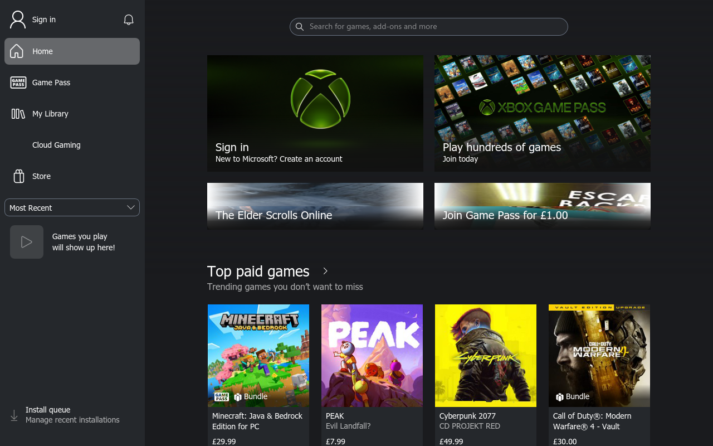
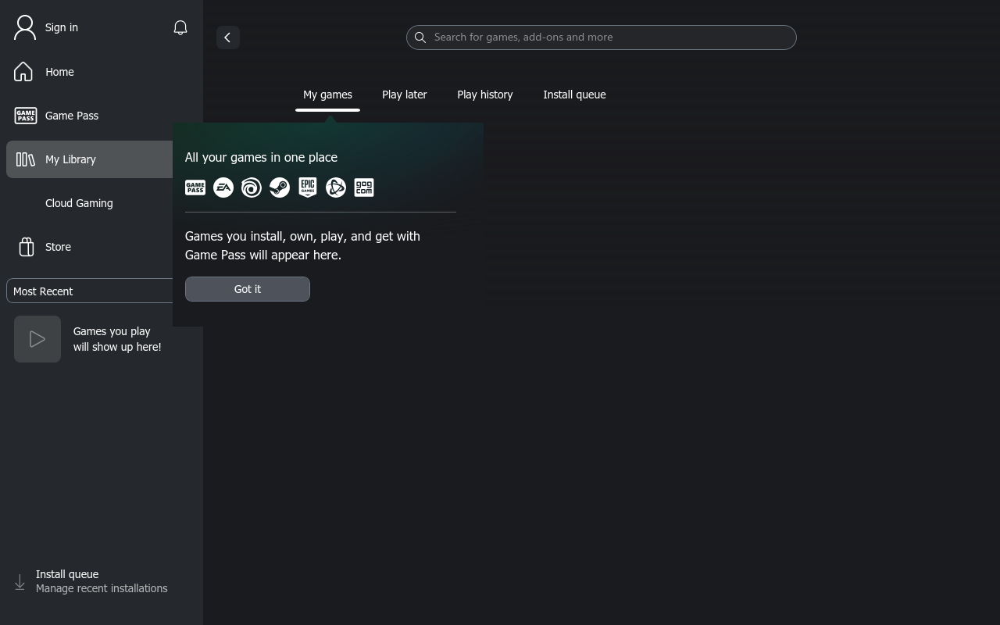

# Original Xbox app under Proton: bounded feasibility check

Initial probes recorded 2026-11-06 on this Linux laptop. At that checkpoint the
original client was not functional. Five isolated startup probes were performed, including two using
the installed managed Proton launcher. This establishes concrete startup
blockers in the tested configuration; it does not establish that every future
Proton build can never run the app.

**Latest checkpoint, 2026-11-08:** the original 2612 package's retained **AppL**
entry now reaches its real signed-out Home screen and My Library under the
private patched Wine-UWP candidate and an explicit experimental compatibility
profile. This is a frontend milestone, not a working default CE entry, native
Gaming Services installation, successful sign-in, or validated game support.
See the final implementation and execution sections below.

## Exact application and runtimes

The input is the user's `Microsoft.GamingApp_2612.1001.23.0` bundle,
SHA-256 `a44c5bb5bc33df73453189e9773485b7da246678ad8574c046c69225142074cb`.
See the [package analysis](xbox-package-2612.md) for its declared identity and
static coverage. The extracted x64 package contains these different entries:

| Entry | Manifest declaration | Executable SHA-256 |
| --- | --- | --- |
| `Microsoft.Xbox.App` | `XboxPcAppCE.exe`, `Windows.FullTrustApplication` | `dc50e62227838178c6f8b1e42463cd2b4a7f4b4f55dfc4b0e672d71a8fed0d89` |
| `Microsoft.Xbox.AppL` | `XboxPcApp.exe`, `XboxPcApp.App` | `fbf58cf91cf5c78b9da8e23847e8e99883ca313306e9f6f3b0e32f8f4eb91bff` |

The CE entry is a packaged desktop executable; describing the entire new client
as only a UWP executable would be inaccurate. The legacy entry still uses UWP
activation. Launching an extracted EXE does not install either entry's package
identity, COM registrations, protocol handlers or framework packages.

The manifest declares VCLibs 14.0, VCLibs UWPDesktop, Microsoft.UI.Xaml 2.8 and
Microsoft.WindowsAppRuntime.2 (minimum 2.1.1.0). It declares package-management
capabilities and several COM, background-task and protocol registrations. The
package includes WebView2, XAML-host, React Native and Xbox host components;
their presence alone does not prove which native host path executes.

Two installed runtime configurations were used:

- Distribution Wine `10.0` (`Ubuntu 10.0~repack-12ubuntu1`).
- XBOKS Engine's existing managed Proton distribution, with patched Wine
  `11.0-20261020-g8411926d`. Its base `version` file identifies
  `xodus-bleeding-edge-11.0-20260803-3-g7c0b4354`. The `proton` launcher SHA-256 is
  `1238e39e95b3d438463e4c095364b4a143af51057e85523f3800ea3aca4d38c2`.

The second is the project's managed Proton derivative, **not a separately
tested current stock Valve Proton or Proton Experimental installation**.

## Execution boundary

Each probe used a fresh private prefix/compatdata directory under ignored
`work/proton-xbox-2026-11-06/`. Bubblewrap unshared the network, PID, IPC and
other namespaces. Only required system paths, the original package and the
selected runtime were mounted read-only; the user's home, session bus, games,
account profile and desktop sockets were not exposed. Prefix writes stayed in
the probe directories. No sign-in, downloads, Windows DLL installation or
changes to the running XBOKS session occurred.

No Xvfb or other isolated display server was available. The probes therefore
test loader/native initialization, **not a displayed UI**. Expected headless
Wine bootstrap warnings are not treated as proof that the Xbox UI is
incompatible. Each capture had a 30-second deadline and a two-second bounded
finalization policy; the two Proton timeouts stopped after SIGTERM. Their
Bubblewrap PID namespaces also bound the lifetime of their children.

## Observed startup results

| Probe | Observed result | Interpretation |
| --- | --- | --- |
| Wine 10, CE EXE | Exit 53; loader status `c0000135`; missing `ext-ms-win-shell32-shellfolders-l1-1-0.dll` and `api-ms-win-shell-namespace-l1-1-0.dll`. | Cannot load this entry in the tested fresh Wine 10 prefix. |
| Wine 10, legacy EXE | Exit 53; loader status `c0000135`; missing `winsqlite3.dll`. | Cannot load the legacy entry in that configuration. This is not a test of correctly registered UWP activation. |
| Engine Wine 11 invoked directly | Exit 53; missing `dxgi.dll`. | Raw Wine invocation skipped the distribution's Proton prefix preparation. This is a setup diagnostic, not a valid general Proton verdict. |
| Managed Proton 11 `run`, CE EXE | Prefix prepared and native CE code reached. `RoGetActivationFactory` could not find `Microsoft.Windows.AppLifecycle.AppInstance`; the log then records `0x80040154`. A fallback involving `msxboxl://` reached a stubbed `Windows.Foundation.Uri.Host` call and `0x80004001`. Capture reached its 30-second bound. | A concrete Windows App SDK activation/WinRT blocker remains after using the actual Proton launcher. No functional client was observed. |
| Managed Proton 11 `run`, legacy EXE | Prefix preparation occurred; the capture reached its 30-second bound without a useful application-level failure in its log. | Inconclusive in this headless, unregistered-package configuration. It does not prove launch success or universal failure. |

Both managed-Proton runs also reported a missing optional AMD DLL during
template copying. The CE run nevertheless reached the AppLifecycle call above.
No dependency bypass or replacement DLL was introduced to conceal these errors.

## Why copying the web payload is insufficient

The package's new web UI is useful reconstruction evidence, but its native
bridge still supplies account, package, install, notifications, input and mode
operations. Rendering those HTML/JavaScript assets in another browser would not
provide those contracts or establish a working original Xbox client.

The CE import table also declares delayed
`RegisterGamingFullScreenExperienceChangeNotification` and
`UnregisterGamingFullScreenExperienceChangeNotification` calls through
`api-ms-win-gaming-experience-l1-1-0.dll`. These are static declarations, not
observed calls in these probes. Even a future successful Wine window would not
by itself implement GNOME's desktop policy or XBOKS's operating-system switcher.

Microsoft documents Windows as the supported platform for the
[Xbox PC app](https://www.xbox.com/en-us/apps/xbox-app-on-pc),
[Windows App SDK](https://learn.microsoft.com/en-us/windows/apps/windows-app-sdk/)
and [WebView2 runtime](https://learn.microsoft.com/en-us/microsoft-edge/webview2/).
Those support statements are not proof of technical impossibility under Wine.
Microsoft separately documents that package identity is an operating-system
property: [GetCurrentPackageFullName](https://learn.microsoft.com/en-us/windows/win32/api/appmodel/nf-appmodel-getcurrentpackagefullname)
can report that the process has no package identity. Extracting files alone does
not satisfy that deployment contract.

[Valve's Proton documentation](https://github.com/ValveSoftware/Proton/blob/proton_10.0/README.md)
describes Proton as Wine plus additional components for Steam Play. In a
[Microsoft Store subsystem question](https://github.com/ValveSoftware/steam-for-linux/issues/13344),
a Valve maintainer directed evaluation to individual Wine subsystems rather
than announcing blanket Store-app support. That issue is context; the exact
local execution results above are the evidence for this candidate.

## Evidence and next useful experiment

Target-free REA PE-import records completed their selected tables:

- CE imports: `ev_d7f5abd5eaf0a263c9d3f60e8ffe85a6165ee4ab8ef0071c64d09556724f163b`.
- Legacy imports: `ev_8e4c3d45be2836c16bfba6f3bc702b3473e41b2efb6b97b902c9eb0840a12a1b`.

The five controlled process captures, in table order, are:

- `ev_3b2c23e224c2e29e97361eac2b9776bcc4afad419ffcc78fbec3c7c27048ab6c`.
- `ev_895dfbe99c497b6780f8086d23d0e906ab6d8d66076cb798b146f72c0ac3ca7f`.
- `ev_6e036aa9b56c17c7c4e3506ece3f8cae2da6bb9e3ddf3b007cc041719e3bd2ee`.
- `ev_f8fe86e7ebce80608681218932acdff63fce0733ff9ec3f7c3292bcd423b6fad`.
- `ev_2477d74e6bde7e320e8f04344f9b3fd1b76cbcc129289c0c5a02d7b05ed3ee77`.

Full records, isolated logs, the execution plan and their hashes remain in
ignored local research storage. Raw terminal frames were retained; rendered
terminal snapshots in the two Wine 10 captures were partially omitted by the
capture budget. Process sampling is not a complete syscall trace. Some captures
reported unverified unrelated root-owned kernel workers; these are not claimed
as owned app processes and were not signaled.

The next gate after these Proton probes was a separately built package-aware
runtime with the actual frameworks. The follow-up below supplies that evidence.

## Wine-UWP follow-up, 2026-11-07

The complete Wine 11.20 source plus the unmodified 486-file overlay from
[designgears/wine-uwp at ac56cede](https://github.com/designgears/wine-uwp/tree/ac56cede08bbb99c5b88dd7b54e752f709cd6b47)
built successfully for x86_64 in 750 seconds. Upstream distribution packaging,
prefix creation, symbol resolution, and installation of the original Xbox
2612.1001.23.0 bundle all returned success. This is an actual runtime test,
not another direct invocation of the extracted executable with ordinary Wine.

The private prefix uses the supplied Windows image 26300.9457, en-GB. All four
declared framework versions passed independent manifest checks before and after
installation: VCLibs 14.0.33519.0, UWPDesktop 14.0.33728.0, XAML 2.8
8.2511.26001.0, and WindowsAppRuntime.2 2.2.0.0. No older-version fallback was
needed. The installer's `older: true` information field is misleading: its source
sets that flag whenever *any* version exists, even when strict availability is
also true.

The upstream setup assumes en-US. Private copies of its script/data files use
en-GB preferred UI languages and the genuine en-GB resource files from the ISO.
No original Xbox manifest, executable, or Windows DLL bytes were patched. The
existing XBOKS engine, prefixes, and runtime selection were not changed.

| Test | Observed result |
| --- | --- |
| Default CE entry, real display | No visible app window. Missing `Windows.ApplicationModel.AppInstance`, followed by an attempted `msxboxl:` fallback. Exit zero did not mean a working client. |
| Legacy AppL entry from the same original package | Created a 1280x800 `XBOX` window showing a solid blue surface, then a program-error dialog. The client had a null-read fault at address `0x14062f689`; no functional UI was observed. |
| CE with the genuine missing provider | The supplied SOFTWARE hive maps `Windows.ApplicationModel.AppInstance` to `ExecModelClient.dll`, omitted by the upstream harvest list. Adding that unmodified DLL and the real class registration to the private prefix advances activation, but the native DLL then fail-fasts with `0xc0000409` during initialization. |

The AppL test changes only the installer's generated `identity.env` AUMID and
executable selection to the original manifest's `Microsoft.Xbox.AppL` entry.
The default generated configuration is retained separately. Both staged Xbox
executable hashes match the original package hashes above.

The provider's imports and exported activation factory were inspected with REA.
A separate factory-load helper and the original CE process both reached the same
native initialization failure; merely supplying the registry mapping is
insufficient. Additional AppL logs also identify missing execution-model classes
and a `daxexec.dll` dependency on `container.dll`; their causal relationship to
the client crash has not been established.

No account sign-in was completed and no game was installed, launched, or
streamed. The app itself initiated device-code requests during startup; these
remain in private diagnostics and are excluded from this report. Owned windows
and Wine processes were closed after each bounded test.

The author's recorded Xbox success concerns
[2608.1001.17.0](https://github.com/designgears/wine-uwp/blob/ac56cede08bbb99c5b88dd7b54e752f709cd6b47/docs/Findings-M4.md#L10658).
The [fresh-prefix Halo record](https://github.com/designgears/wine-uwp/blob/ac56cede08bbb99c5b88dd7b54e752f709cd6b47/docs/Findings-M4.md#L12748)
uses a WoW64 build, the development Windows-component tree, and a copied sign-in
store. It verifies the download flow and then reuses an existing game payload.
Our newer client, different Windows-component build, and x86_64-only runtime
are not an exact reproduction of that matrix. This failure does not disprove
the reported 2608 result or establish universal impossibility under Linux.

At this checkpoint the next compatibility task was the failing ExecModelClient
initialization contract. The corrections and subsequent launch results are
recorded below. Neither the new nor retained legacy 2612 UI is currently
accepted as functional.

Selected runtime evidence:

- Prefix setup: `ev_198714b2f709872bcca2407c021f3ec4d665ec9446ada787b1d06c50a83756d2`.
- Installer information: `ev_19935707148b212ebe5bd2029dfdc579408eda52afbe0900c95abb5b9eefd2f6`.
- Actual install: `ev_4e2e19d6e032a2c9fff125cbba5d5f6ec6599a408cf3dc922b85bc462e23d06e`.
- CE baseline: `ev_5cff84ef3022a969a41fea395639415b791d06b725fb01f38f6cccfed9a29445`.
- AppL: `ev_d22ca3ffe5084e34801f9b5130650a7325e59ab7b1cc18ba026826e1c956e0bc`.
- ExecModelClient imports: `ev_904b8a25faeacec486612d1301667413e424f4a54386e6dc80236186d0a25299`.
- Factory-load probe: `ev_5daf02263985d731bdf73be0422c058e7d3289eda921359159511976f06b6c13`.
- CE with the real AppInstance provider: `ev_86283abad4dcf86b2d2e00c793ce6c33d2f7b8cdfc66acaec8bd27185566dd3f` (exit 9, no observed window).

The install capture's progress output and the factory helper's console rendering
were truncated by capture budgets; separate operation results and staged hashes
provide the completion checks. Full private captures, source/build proofs,
framework inventories, and window screenshots remain in ignored local research
storage. No raw authentication diagnostics or Microsoft payloads are published.

## ExecModelClient initialization correction, 2026-11-07

The `0xc0000409` initialization failure above is resolved in a private Wine
candidate. Microsoft DLL bytes remain unchanged.

The matching ExecModelClient PDB identifies the failing CRT initializer at RVA
`0x14290`. REA/GDB disassembly shows its call through IAT slot `0x42a08`, which
the complete PE-import record identifies as `combase.#66`. The initializer
checks the returned HRESULT and enters WIL fail-fast on failure. The matching
native combase PDB and export table identify the actual Windows functions:

| Ordinal | Native Windows function | Previous Wine binding |
| --- | --- | --- |
| 66 | `CoGetSharedServiceId` | `CLIPFORMAT_UserFree` |
| 67 | `CoAddRefSharedService` | `CLIPFORMAT_UserMarshal` |
| 68 | `CoReleaseSharedService` | `CLIPFORMAT_UserSize` |

Native disassembly of `CoGetSharedServiceId` and its internal implementation
shows that it writes the calling thread's `SubProcessTag` to a DWORD output,
creates a persistent service record when needed, and returns a real allocation
error or `E_INVALIDARG` for a null output. AddRef/Release maintain a per-service
reference count. The implementation preserves that state under a lock, rather
than replacing the failure with a constant-success stub.

The [portable source patch](patches/wine-uwp-shared-services.patch) applies to the
Wine 11.20 plus pinned wine-uwp overlay used above. It reserves ordinals 66–68
for those functions and moves only the three conflicting CLIPFORMAT exports to
1000–1002. Complete before/after export comparison preserves all 372 existing
names and every other ordinal/forwarder. Windows SCM shutdown/timer callbacks
remain unsupported, and native behavior for invalid or unbalanced IDs is not
claimed.

The modified combase built successfully and was installed only into the private
distribution and prefix. Candidate PE SHA256:
`cef7ad4ffe0b1c7ec705c9454d7241829a070b63b9b9cdb105c0faabe0fee6c2`.
The [standalone ABI test](probes/wine-uwp-shared-service-tests.c) passed with zero
failures, including buffer guards, TEB-derived IDs, per-ID isolation, persistence,
and 16,000 balanced reference pairs across eight threads. More decisively, the
same unmodified ExecModelClient DLL now loads and returns a non-null AppInstance
activation factory with `S_OK`, where the previous runtime fail-fasted.

The original CE entry was retried with the corrected runtime. It no longer
fail-fasts and exits zero after requesting `msxboxl:///`; it did not present a
visible UI. The launcher log alone does not establish why it selects that path.
A subsequent AppL trial progressed into ExecModelClient methods but encountered
a different missing export: `GetApplicationUserModelId`, producing delay-load
exception `0x505`. The user's supplied crash dump matches that observed path.

Evidence for this correction:

- Initializer disassembly: `ev_e4d9a391b866314eb6325c45ea3c22ffa5ce7ab58a3edd0c71e86244bb5030df`.
- Native shared-service ID implementation: `ev_4c0d5dfd95ae1cc5fc16933b6061ae4c0233d31b55d908e2a3f58f21e87f923f`.
- Complete candidate export table: `ev_5b7fbf85be4f95c1f99aac2570d425ed07c5cbfeb134a3982f35975b584dd5bf`.
- Executed ABI test: `ev_05fd259cec03d9e12eb8d4fbac4a4107932740afa4d52eabc6d00dd1eb014006`.
- Executed native factory-load test: `ev_787e92d2cf1359395aec7e166799278cf6e6f7a30be6f686914533d835880c5a`.
- Original CE retry: `ev_c28eca5c7d2f2d9408c0926c35ac42038e85a4df2e8e665c62357fcf34b0c529`.
- AppL retry and next missing export: `ev_950ec266d33f95404dca56edeb9f7d67d8190ed2d358091cb463154853d2f724`.

This is a verified fix for one initialization contract, not acceptance of a
functional Xbox client or a change to the installed XBOKS engine selection.

## Process identity export correction, 2026-11-07

The user's `0x505` dump corresponds to a delay-load failure for
`api-ms-win-appmodel-runtime-l1-1-0.dll.GetApplicationUserModelId`. The API-set
already maps to kernelbase, but that named export was absent. The
[source patch](patches/wine-uwp-process-aumid.patch) supplies the current-process
implementation and kernel32 forwarder, preserving all 1,486 kernelbase and
1,369 kernel32 existing export bindings. The function uses the actual staged
package AUMID and the existing size/buffer contract. It validates process
handles rather than returning the caller's identity for an arbitrary process.

The [executed probe](probes/wine-uwp-process-aumid-tests.c) passed with zero
failures: API-set and direct exports, pseudo/opened current-process handles,
null/short/exact buffers with guards, invalid and insufficient-access handles,
and the no-identity case. A valid foreign process returns
`ERROR_NOT_SUPPORTED`; reading another process's AUMID is not implemented.
This is a bounded compatibility implementation, not full cross-process API
conformance. The public contract is documented by
[Microsoft](https://learn.microsoft.com/en-us/windows/win32/api/appmodel/nf-appmodel-getapplicationusermodelid).

The rebuilt DLLs were installed only into the private candidate and test prefix:

| Candidate DLL | SHA256 |
| --- | --- |
| kernelbase.dll | `44de75f9ce4c0279ed3f71301646563247f31a9c1ff5d9af0b50e1841262a6c8` |
| kernel32.dll | `996065be650bba0d439ddf5676305b43fd769ca366318cc8c3a7acb4d808caa8` |

Runtime API evidence:
`ev_b519fdceac994185098cf4b1cc24dcd08b967c0eee23e02bb02b4a0ae03efb14`.
The original AppL retry no longer encounters that missing export, but still
faults at `XboxPcApp.exe+0x62f689` after showing a blue XBOX window:
`ev_907a08bfcb635283607addac1a0e0b6334e7fd6fae849add89b2815a70d1153d`.

## Package-volume interface investigation, 2026-11-07

Static REA/GDB analysis of the original executable identifies the null-read
path precisely. The function queries IID
`DAAD9948-36F1-41A7-9188-BC263E0DCB72`, then dereferences the resulting null
interface pointer before invoking vtable offset `0x58`. Embedded generated-code
strings identify `Windows.Management.Deployment.IPackageManager3` and
`FindPackageVolumes`. The pinned Wine overlay comments out that interface and
does not expose it from PackageManager. This agrees with both the observed
GUID and the method's ABI position.

Evidence retained from the original executable:

- Fault-path disassembly: `ev_b905202d021ef170a84c316a613c3bce73f59c97250a9f01d64b48f9da570001`.
- Queried IID bytes: `ev_8abca88e9d23856b0c931ea534fdd058a4641f30e131a5f6b9fd20153d7c4c83`.
- Embedded generated header path: `ev_92e34f96ce9ff60e3c51e0d70bef170a377cb64bfa3ddc9ef99edc8432e505b1`.
- Embedded method signature: `ev_6a3a029c92ce5c6153f3f1a2c8cc57bed7ad5c73a3ef71eefaa010732afee6df`.

## Package-volume interface correction, 2026-11-08

The [source patch](patches/wine-uwp-package-manager3.patch) adds the complete
15-method interface ABI and reuses the existing Wine system-volume objects for
`FindPackageVolumes`, default-volume retrieval, and lookup of that known volume.
Its GUID and vtable ordering were checked against
[Microsoft's pinned interface definition](https://github.com/microsoft/windows-rs/blob/9769d429fa2bd3a8b5641443c080aa6f166d342e/crates/libs/windows/src/Windows/Management/Deployment/mod.rs).
Name matching checks HSTRING length before the case-insensitive comparison,
including embedded-NUL suffixes. Unsupported mutations return `E_NOTIMPL` with
cleared async outputs. The existing capacity/capability implementation is
unchanged. Enumeration represents Wine's system volume only; lookup of other
names returns `E_NOTIMPL` rather than claiming complete native behavior.

The affected module built successfully, preserving all 82 existing export
bindings. Candidate DLL SHA256:
`bfdbb0fd9c85b8f1c8dc4766f4225e6fa994e4d597d3da740bc2beb1f6fc223d`.
It was installed into the private distribution and matching prefix only.

The [independent raw-vtable test](probes/wine-uwp-package-manager3-tests.c)
compiled without the modified deployment header and executed with zero
failures. It exercises all 15 slots, the exact `+0x58` call, QI identity,
reference ownership, iteration, default/name lookup, null outputs, embedded-NUL
names, and explicit unsupported-operation errors. The returned mount was `C:\\`,
consistent with the private prefix's system directory. This establishes the
tested interface subset, not working package deployment or client startup.

- Complete candidate exports: `ev_f0ada1f31db98ecf727a9f7f2ea74608b543d8f9a26d2ece40b1a2a43dd78918`.
- Executed interface probe: `ev_53733e3139cffd89b3d7796002f776014d961df8690117c9433a82837b7935ac`.

## Original-client retry and current dependency gate, 2026-11-08

With all three corrections, the unmodified AppL executable no longer produced
the previous null-read or delay-load exception during the bounded observation.
It progressed beyond the blue surface and rendered its own React Native update
error card: **Try the update again**, `0x80004001`, over **Launching XBOX**.
No functional home screen was accepted. This trial reached the launcher's
90-second limit; exit 124 is the bounded-test timeout, not a new exception.
Window observations and screenshots cover approximately 95 seconds.

The targeted appx trace records a call to
`IPackageManager3.AddPackageToVolumeAsync`, which returns `E_NOTIMPL` in the
candidate. A second trace using the app's own TraceLogging events establishes
the causal chain, rather than inferring it from the shared HRESULT:

1. The original `gamingservicesconfig.json` requires **39.118.30001.0** and
   administrative installation. The bundled Gaming Services package has the
   same version.
2. Wine-UWP's compatibility registration advertises **37.114.26001.0**. This is
   an upstream stand-in identity, not evidence that Microsoft's actual Gaming
   Services are running.
3. The app logs `VerifyMinVersionRequirements`, then a Gaming Services
   deployment requirement of `LocalUpdate` and enters `Updating`.
4. The actual `AddPackageToVolumeAsync` call returns `E_NOTIMPL`.
5. `Dependency::InstallLocalPackage` reports `0x80004001`, followed by
   `InsufficientVersion` and the matching dependency-error notification.

The setup's current service registrations are no-op stand-ins, and the
Wine-UWP platform provider implements a compatibility subset. The supplied
Gaming Services bundle also contains service executables, packaged-service
extensions, and the `gameflt.sys` / `xvdd.sys` kernel drivers. The existing
installer's file staging does not supply a general AppX/service deployment
implementation. Merely extracting the bundle or changing the advertised
version would not establish service compatibility. No version increase or
success-only deployment bypass was applied.

The next substantial compatibility task is the Gaming Services 39 requirement:
assess and implement the client-facing API/service contracts needed by 2612,
with explicit provider provenance and actual deployment/inventory behavior.
Windows kernel-driver support is not supplied by these three fixes. The
current result proves progress through startup and the specific earlier crash
fixes; it does not establish successful login, installation, streaming, or game
execution. The default CE entry's earlier `msxboxl:` fallback remains a separate
unresolved path.

Selected runtime evidence:

- AppL after the interface fix: `ev_c13805272ccd6645aaed3dc8b0c9d9c879edd4fa34448612d92261be18ea2bfc`.
- Targeted appx/platform trace: `ev_509e19a8078576e72bbedd7b91aa7c8015ef4bd30ce3b17c5c6108e6303a03f4`.
- App-emitted dependency/version trace: `ev_d9b40f61ccf01c9a947df00a0d81aca3719f4f18fcc852e92dab61b7ad0de608`.

Raw authentication and TraceLogging diagnostics remain in ignored private
research storage. `WINE_UWP_LAUNCHER=log` suppresses browser opening only; it
does not complete or cancel the app's own device-code polling. No account
authorization was entered, no refresh-token store was copied, and no game
download or launch was attempted.

All three portable patches passed a reverse-application dry run against the
tested source tree. Original Xbox executable/manifest hashes were checked again
after the final trial. The generated launch selection was restored to its
saved default CE configuration, and no process declaring the private test
prefix remained. The patches and probes are retained as research source;
the installed XBOKS engine/update channel was not changed.

## Next implementation scope: 2612 client ABI, 2026-11-08

A fresh table generated from the actual 2612 client's
`Microsoft.GamePlatform.Services.winmd` was compared by class name, GUID and
ordered slot signature against the current Wine GamePlatform table, excluding
mere class reordering. It contains 23 factory/instance entries against the
candidate's 21. `DesktopPackage` and `DesktopUtilities` are new. `ContentAccess`,
`Licensing` and `PackageInstance` have changed interface IDs and method tables.

This is a client-metadata comparison, not a complete comparison of the native
Gaming Services 39 implementation. Metadata identity SHA256:
`b7afe87a6849f996bbb7ac1509faa4747217e919ec44c184cfab3fd7ae525d98`;
MVID `f5a1473b-2d20-4bfc-8f37-634d2acd0678`. Static identity evidence:
`ev_e08ed179ed5ba2584e18fbb9c8a0ed6cf6e9ccd439a56f34f13dc2e505d6f652`.

In particular, PackageInstance methods are inserted before existing methods,
not only appended. Its new table reaches slot 42, beyond the current factory
table's 40 slots. A blind metadata-table replacement would therefore be
incorrect: current handlers are indexed by old slot positions, and newly
exposed interfaces need proper ABI adapters and bounds. These differences are
potential next failures after the current dependency gate, not observed causes
of the update dialog.

The first implementation unit should provide explicit adapters for the 2612
interfaces, preserve supported older interfaces, and map implemented methods
by their actual signatures. Independent raw-ABI probes should cover QI,
ownership, slot bounds, method routing and unsupported errors before any
provider compatibility declaration changes. Package inventory must distinguish
staged original files from the Linux compatibility provider. The first client
acceptance gate remains a real signed-out home screen and navigation, followed
separately by sign-in, installation and game launch.

A further local metadata audit found that the GS39 bundle's root GamePlatform
WinMD is byte-identical to the retained GS38 metadata, while the 2612 app ships
a different client WinMD. Thus the adapters must follow the actual client's
contracts, not a version-number assumption about the service bundle. The audit
also identifies changed client Identity/XboxAuth contracts for follow-up;
GamePlatform's three changed interfaces are not the whole authentication
compatibility surface. No runtime compatibility claim follows from metadata
matching alone.

## Implemented 2612 adapters and executed probes, 2026-11-08

The [GamePlatform patch](patches/wine-uwp-gameplatform2612.patch) preserves the
legacy interfaces and adds separate typed interfaces for the 2612
ContentAccess, Licensing and PackageInstance contracts. The new PackageInstance
table has 43 slots, with shared COM ownership and canonical IUnknown identity.
Its implemented methods map to the corresponding existing handlers; inserted
methods cannot shift calls into an unrelated legacy handler. The new
DesktopPackage and DesktopUtilities factories return explicit unsupported
errors. DesktopPackage.Register correctly uses a two-HSTRING result struct,
clearing both fields on failure. Existing factory activation limitations remain;
this does not establish general RoActivateInstance support for these classes.

The [XboxAuth patch](patches/wine-uwp-auth2612.patch) supplies the new manager,
user, statics, async User IID and event-result layouts. It preserves legacy QI
contracts and selects the new constructor/default layout with
`WINE_UWP_IDENTITY_ABI=2612`. That selection is necessary because the constructor
factory IID itself did not change, although its returned class's default
interface did. On the old default layout, the new silent-sign-in slot could
reach the old optional-UI method. The controlled original-client runner enables
the new layout only for the verified 2612 executable and client metadata.

Unsupported new methods remain explicit errors, including RestartApps,
LocalId, NonRoamableId, UI ticket operations, Store account properties and
sandbox controls. These adapters do not fabricate an authorized user, license
or installed game.

| Built DLL | SHA256 | Export check |
| --- | --- | --- |
| winegameplatform.dll | `611200653c652ee30a3a545248e9c27119cd72d1d7614398cf553caf4d32f31e` | Both prior bindings preserved |
| winexboxauth.dll | `3117f04a43e376770ed01903820b5884c22f89cda9bde5a45548ccda6748a48f` | All 9 prior bindings preserved |

Both modules and probes built without warnings. Only the private distribution
and exact research prefix received these DLLs, with original copies retained.
The independent read-only review found and corrected the DesktopPackage result
struct size before execution.

Executed checks:

- [GamePlatform raw ABI probe](probes/wine-uwp-gameplatform2612-tests.c): zero
  failures across old/new interfaces, ownership, slot routing, high-slot access,
  unsupported-result guards, actual system-volume capacity/default mapping and
  the actual empty private package queue. It did not download or install games.
  Evidence: `ev_429705a9631132d57cb9def47bda3a56f7787f3c1faf60731fa9539d108435a7`.
- [Real-provider XboxAuth probe](probes/wine-uwp-auth2612-tests.c): 90 checks,
  zero failures, covering constructor profiles, new/old interfaces, typed async
  results, no-account silent operations and guarded error outputs.
  Evidence: `ev_237227349c27e4c26dccb16e7486f156759f0890ac3593f717807569d6d6a5d1`.
- [Synthetic internal User fixture](probes/wine-uwp-auth2612-user-fixture.c):
  42 checks, zero failures, covering getters, default User/event pointers,
  ownership and slot routing. It compiles the provider source with an in-memory
  synthetic account solely in a separate executable; it is not successful
  sign-in evidence and exposes no test account through the production DLL.
  Evidence: `ev_5994652f11e0041df11d49b6c6e80ba9f7088bdd185e21d729ecc1e1154058af`.

The fixture uses the build-time `IDENTITY_SOURCE` macro to select the patched
provider source and links the real provider objects. Its exact compile command
and object identities are retained in the private fixture build proof. For a
fresh Wine configure, generated dependencies include the new client header;
the existing incremental build explicitly recompiled main.c to include its
final contents.

## Experimental original-client UI result, 2026-11-08

An explicitly opt-in, default-off profile was used to test the frontend after
the ABI checks passed. It temporarily exposes version 39 as an **emulated
client-contract target**, with Wine-provider provenance and explicit
`NativeServicesInstalled=0` / `NativeDriversInstalled=0` records. It also
registers the two new compatibility factories. This is a diagnostic version
alias; it is not genuine Gaming Services deployment or proof of full version
39 compatibility. The upstream provider's readiness behavior remains a known
limitation.

The profile is applied after upstream setup, which otherwise rewrites version
37. Before launch it checks the exact DLL/client metadata hashes and binds the
passing probe records to their operations, helper hashes and tested DLLs. It
exports every affected registry branch first. Finally it stops the owned
command session, restores the branches and compares their exported bytes,
restores the default CE launch selection, and closes the private Wine server.
Both actual trials passed those rollback comparisons. A separate synthetic
rollback guard also rejected a corrupt backup before any registry call.

The first trial displayed the original signed-out **Sign in / Browse app**
screen. The second used the actual Browse app button and reached **Home**:

The actual My Library navigation and its first-use panel also rendered:

The app's own trace subsequently reports `currentRoute: Store`, but a valid
final Store screenshot was not obtained before the bounded trial ended. A
capture made after window shutdown was rejected and removed; it is not Store
UI evidence. The observer now rechecks process/window ownership and image
dimensions after capture to reject that race.

Neither trial produced the previous page-fault/delay-load crash. Both recorded
zero automatically launched device-code pages, whereas the earlier mismatched
ABI trial logged repeated requests. They ended at the deliberate 90/150-second
app deadlines, returning 124, rather than remaining installed/running.

Execution evidence:

- Signed-out gate trial: `ev_d10b4f394b859757aebd399cb425c1344f8bffbbb40888e7645e82a41bf3f99d`.
- Browse/Home/Library trial: `ev_77a505fc3614c09a0b215c0f149a0c2590e81bef6655a069e519a2d13a21f2cc`.

Remaining acceptance work includes visual/rendering defects (including some
navigation icons and banner effects), authenticated Store/OnlineId calls,
actual sign-in, installation and game launch. The logs still report unsupported
OnlineId and AppConfig paths and account-dependent failures. No purchase,
license acquisition, cloud-save transfer or game operation was performed.
The default CE/new-host entry was then retried with the same candidate and
experimental profile. It exited zero after requesting `msxboxl:///`, with no
observed window. That fallback request does not establish its selection reason
or a working CE frontend. Evidence:
`ev_a1cc3910fe4b94ed0ffb14c0360c11c359eb016f90468c94fe8053df8e4afb50`.
Its temporary registry changes also restored successfully. The installed XBOKS
app and runtime/update selection were not changed or published by this
experiment. [Reproduction notes](wine-uwp-client2612-reproduction.md) describe
the source baseline, patches, independent probes and bounded existing-lab
commands.

## Manual sign-in trial and MediaPlayer lifetime fault, 2026-11-08

At the user's request the AppL client was launched in an interactive session
without a test deadline. Automatic screenshots were disabled. A host bridge
opened only a newly issued, strictly allowlisted Microsoft device-code URL in
the normal desktop browser; URL contents, credentials and authentication
diagnostics stayed private. The user completed the Microsoft sign-in and
reported that the app then closed. That session returned exit 5 after roughly
88 seconds, and its experimental registry changes restored successfully.

The recorded fail-fast context identifies an unchecked QI at
`XboxPcApp.exe+0x894a4`, with `E_NOINTERFACE`, followed by a null dereference at
`+0x894b4`. Static REA/GDB inspection of the original executable identifies the
requested IID as `00000038-0000-0000-C000-000000000046`
(`IWeakReferenceSource`). The embedded generated-code function names
`winrt::weak_ref<Windows::Media::Playback::IMediaPlayer>::from_com_ref`.

The prefix registers MediaPlayer to Wine's
`windows.media.playback.mediaplayer.dll`. The tested builtin lacked that QI
contract. This maps the crash to MediaPlayer weak-reference lifetime support,
rather than inferring an authentication failure from the timing alone.

- Queried IID bytes: `ev_9952078135bf7f0e74a13043a464fa68836355fc28211c1333219d46205ace47`.
- Embedded generated header: `ev_a693728ebf5fa3a4e9a55a1710d11611e25d2c02bf31da55742ecf93adf9bb8f`.
- Embedded MediaPlayer weak-ref function: `ev_e485d9e909587ddcc2a9c9709b2c07d06004d2f350aab5c81b988a37364556ff`.

The focused correction uses Wine's existing CAS-based weak-reference control
block with separate strong and weak lifetimes, adds null-output guards and
routes all player interfaces through the central strong-reference count.
Weak handles must not keep the player alive, and Resolve after destruction
must return `S_OK` with a null result. Independent review found no blocking
lifetime issue. The affected module built successfully; executed probe and
repeat manual-session results are recorded in the subsequent checkpoint.

## MediaPlayer correction: executed lifetime checks, 2026-11-08

The [MediaPlayer patch](patches/wine-uwp-media-weakref.patch) built successfully
and preserves all three prior export bindings. Candidate DLL SHA256:
`da9886dd0aff8093abdc68692989eb1d54a51744af1a8ef5c890d638a19064a8`.
It was installed into the private distribution and exact research prefix only.

The [independent raw-ABI probe](probes/wine-uwp-media-weakref-tests.c) activated
the actual registered player and passed 39 checks with zero failures. Its
six-thread Resolve/final-release stress recorded 6,049 live resolutions and
3,669,074 expired resolutions, with zero errors. The test releases the strong
IWeakReferenceSource handle before expecting destruction, and confirms that a
weak handle alone does not retain the player. This does not test media decoding
or audio/video playback.

- Executed lifetime probe: `ev_c9211b52c7ddebe8a7ca6529e9d531362209e2ffd46ad44c61cd2af34c19af66`.
- Complete candidate exports: `ev_81b63b09fda1e14d0cadca660ebbf5c170424da33a38294cbaa1d74bc3b0bc6e`.

The experimental profile now checks the additional MediaPlayer DLL hash and
its exact passing probe result before launching. The original client was
reopened interactively at the user's request, with no automatic screenshots
and no app timeout. A repeat account-stability result requires observation of
that interactive session; passing the lifetime probe alone does not establish
successful authenticated operation.
